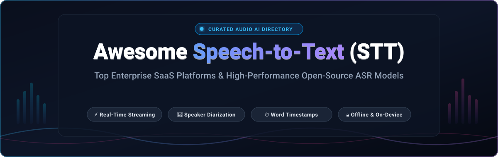

# 🎙️ Awesome Speech-to-Text (STT)

<p align="center">
  
</p>

<p align="center">
  <a href="https://github.com/ishandutta2007/Awesome-Awesome-Awesome"></a><a href="https://discord.gg/jc4xtF58Ve"></a>
  <a href="https://github.com/ishandutta2007/Awesome-Speech-To-Text-STT/stargazers"></a>
  <a href="https://github.com/ishandutta2007/Awesome-Speech-To-Text-STT/network/members"></a>
  <a href="https://github.com/ishandutta2007/Awesome-Speech-To-Text-STT/issues"></a>
  <a href="https://github.com/ishandutta2007/Awesome-Speech-To-Text-STT/pulls"></a>
  <a href="https://github.com/ishandutta2007/Awesome-Speech-To-Text-STT/blob/main/LICENSE"></a>
  <a href="https://github.com/ishandutta2007"></a>
</p>

---

## 📖 Overview

A definitive, SEO-optimized curated directory of **Speech-to-Text (STT)**, **Automatic Speech Recognition (ASR)**, and **Voice AI** technologies. Whether you are architecting ultra-low latency conversational AI voice agents, building automated podcast and meeting transcription pipelines with speaker diarization, generating frame-accurate video subtitles with word-level timestamps, or deploying self-hosted offline inference models for privacy and data sovereignty, this repository tracks the top enterprise SaaS solutions and open-source models available.

---

## 📑 Table of Contents

- [🌐 Sector Overview & Market Dynamics](#-sector-overview--market-dynamics)
- [☁️ Top SaaS & Hosted STT Platforms](#️-top-saas--hosted-stt-platforms)
- [💻 Open-Source GitHub Projects](#-open-source-github-projects)
- [🎯 Architecture & Selection Guide](#-architecture--selection-guide)
- [🤝 How to Contribute](#-how-to-contribute)
- [📈 Star History](#-star-history)
- [💖 Support & Sponsoring](#-support--sponsoring)
- [⚖️ Disclaimer](#️-disclaimer)

---

## 🌐 Sector Overview & Market Dynamics

The global **Speech-to-Text (STT) and voice recognition market** was valued at approximately **$13.5 Billion in 2024** and is projected to surpass **$48.5 Billion by 2032**, expanding at a robust Compound Annual Growth Rate (**CAGR**) of **17.5% – 21.2%**. This exponential surge is catalyzed by the proliferation of real-time conversational AI voice agents, contact center automated intelligence, automated medical and legal charting, multilingual video dubbing, and regulatory accessibility mandates.

From a structural perspective, the sector is **moderately fragmented** rather than a winner-take-all monopoly. While cloud hyperscalers (Microsoft Azure, Google Cloud, AWS) maintain formidable scale, bundled distribution, and enterprise governance, specialized pure-play providers (Deepgram, AssemblyAI, Rev AI, Speechmatics) command significant developer and enterprise share by competing aggressively on sub-300ms streaming latency, domain-specific acoustic fine-tuning, and developer ergonomics. In parallel, the rapid maturation of open-source architectures—anchored by OpenAI's Whisper ecosystem, CTranslate2 inference engines, and quantized edge runtimes—has empowered engineering teams to deploy sovereign, cost-effective on-premise and on-device transcription pipelines, preventing proprietary lock-in.

---

## ☁️ Top SaaS & Hosted STT Platforms

The table below compiles leading commercial Speech-to-Text platforms, featuring concrete starting tier pricing, explicit free tier / trial terms, and sorted descending by **Company Scale (Valuation / Revenue)**:

| 🏢 Platform / Service | 🎯 Core Focus & Capabilities | 💵 Starting Tier Pricing | 🎁 Free Tier / Trial Limits | 📊 Company Scale (Valuation / Revenue) |
| :--- | :--- | :--- | :--- | :--- |
| **[Microsoft Azure Speech-to-Text](https://azure.microsoft.com/en-us/products/ai-services/speech-to-text)** | Global enterprise ASR supporting 100+ languages, custom acoustic/language models, real-time streaming, speaker diarization, and tight Azure OpenAI integration. | **$1.00 / audio hour** ($0.0167 / minute) for Standard pay-as-you-go | **5 audio hours / month free forever** (F0 free tier); $200 Azure credits on 30-day trial | **~$3.1 Trillion** (Market Cap) / ~$140B Cloud ARR |
| **[Google Cloud Speech-to-Text](https://cloud.google.com/speech-to-text)** | Mature, scalable STT API featuring Chirp 2 foundational model, 125+ languages, automatic punctuation, multichannel recognition, and Vertex AI ecosystem connectivity. | **$0.016 / minute** ($0.96 / hour) for standard v1 batch & streaming models | **60 minutes / month free forever**; $300 new customer credits for 90 days | **~$2.2 Trillion** (Alphabet Market Cap) / ~$40B Cloud ARR |
| **[Amazon Transcribe](https://aws.amazon.com/transcribe/)** | Fully managed AWS speech recognition service with real-time streaming over WebSockets/HTTP2, custom vocabularies, PII redaction, and contact center call analytics. | **$0.024 / minute** ($1.44 / hour) for first 250,000 minutes / month | **60 minutes / month free for 12 months** on AWS Free Tier | **~$1.9 Trillion** (Amazon Market Cap) / ~$105B AWS ARR |
| **[Verbit](https://verbit.ai/)** | Enterprise transcription and captioning platform combining proprietary speech AI with human-in-the-loop verification; specialized for legal, higher ed, and media compliance. | **$0.15 / minute** ($9.00 / hour) for automated transcription and captioning self-service | **14-day free trial with up to 60 minutes** of automated transcription | **$2.0 Billion** (Valuation - Series E Unicorn) / ~$100M ARR |
| **[Otter.ai](https://otter.ai/)** | AI meeting assistant that automatically joins Zoom, Google Meet, and Microsoft Teams to deliver real-time live transcription, automated summaries, and action item capture. | **$10.00 / user / month** ($120/yr billed annually) for Pro tier (1,200 mins/month) | **300 minutes / month free forever** (up to 30 minutes max per conversation) | **$1.1 Billion** (Valuation - Series B Unicorn) / ~$60M ARR |
| **[AssemblyAI](https://www.assemblyai.com/)** | Developer-centric speech AI API powered by Universal-2; provides streaming ASR, speaker diarization, sentiment analysis, PII redaction, and audio LLM synthesis. | **$0.0061 / minute** ($0.37 / hour) for async batch; **$0.0075 / minute** ($0.45 / hour) for real-time streaming | **Free tier with $50 monthly recurring credit** (~135 hours free transcription) | **~$300 Million** (Valuation - $115M Raised) / ~$30M ARR |
| **[Speechmatics](https://www.speechmatics.com/)** | Autonomous Speech Recognition (Ursa model) renowned for industry-leading accuracy across diverse accents, real-time streaming, and GDPR-compliant sovereign cloud/on-prem. | **$0.0125 / minute** ($0.75 / hour) for Standard batch & streaming; **$0.0208 / minute** for Enhanced | **8 hours (480 minutes) / month free forever** on self-service SaaS | **~$150 Million** (Valuation - $62M Series B) / ~$25M ARR |
| **[Deepgram](https://deepgram.com/)** | High-throughput, end-to-end deep learning STT engine (Nova-3 & Nova-2) built for conversational voice agents with sub-300ms streaming latency and high noisy-audio accuracy. | **$0.0043 / minute** ($0.258 / hour) for Nova-2 pre-recorded; **$0.0059 / minute** ($0.354 / hour) for streaming | **$200 free credit on signup** (~46,500 pre-recorded minutes, no credit card required) | **~$125 Million** (Valuation - $125M Raised) / ~$25M ARR |
| **[Rev AI](https://www.rev.com/)** | Battle-tested speech recognition API trained on 50,000+ hours of human-transcribed audio, featuring custom vocabulary, sentiment analysis, and seamless fallback to human review. | **$0.02 / minute** ($1.20 / hour) for automated ASR; optional 99%+ accurate human review at $1.50 / min | **5 hours (300 minutes) free trial credits** on account registration | **~$100 Million+** (Annual Revenue) / ~$200M+ Valuation |
| **[Trint](https://trint.com/)** | Web-based collaborative transcription and audio-text storytelling platform engineered for journalists, newsrooms, media organizations, and broadcast production teams. | **$48.00 / user / month** (billed annually) for Starter tier (up to 300 transcription mins/month) | **7-day free trial with up to 3 transcription files** (up to 180 minutes total) | **~$15 Million ARR** ($30M+ Raised, Acquired by Bending Spoons) |
| **[Sonix](https://sonix.ai/)** | Automated speech-to-text platform with interactive browser transcript editor, automated multi-language translation, subtitle burn-in, and multi-track audio processing. | **$10.00 / hour** ($0.167 / minute) standard pay-as-you-go; or **$5.00 / user / month** + $5.00 / hour Premium | **30 minutes of free audio/video transcription trial** (no credit card required) | **~$10 Million ARR** (Profitable, Private / Bootstrapped & Acquired) |

---

## 💻 Open-Source GitHub Projects

Curated collection of premier open-source Speech-to-Text and audio machine learning frameworks for self-hosting, local offline execution, and embedded edge deployment. **Sorted strictly by GitHub Stars_Count (Descending)**:

### 1. [Whisper](https://github.com/openai/whisper) [](https://github.com/openai/whisper/stargazers)
- **Description**: The foundational general-purpose speech recognition model trained on 680,000 hours of multilingual, multitask supervised web data. Supports 99 languages, automatic language identification, phrase translation, and word-level timestamps. Serves as the benchmark weights for modern speech AI.
- **License**: MIT
- **Best For**: Foundational research, offline batch transcription, and base model weights.

### 2. [whisper.cpp](https://github.com/ggml-org/whisper.cpp) [](https://github.com/ggml-org/whisper.cpp/stargazers)
- **Description**: High-performance, dependency-free C/C++ implementation of OpenAI's Whisper model. Features quantized GGUF models (1.5-bit to 8-bit), Apple Silicon Metal acceleration, CUDA, Vulkan, and OpenVINO support. Runs on Raspberry Pi, iOS, Android, and WebAssembly.
- **License**: MIT
- **Best For**: Embedded edge devices, native desktop apps, mobile platforms, and zero-Python deployments.

### 3. [faster-whisper](https://github.com/SYSTRAN/faster-whisper) [](https://github.com/SYSTRAN/faster-whisper/stargazers)
- **Description**: Reimplementation of Whisper utilizing CTranslate2, delivering up to **4x faster inference speed with identical accuracy** and significantly lower VRAM consumption through 8-bit quantization on both CPU and GPU.
- **License**: MIT
- **Best For**: Production self-hosted server deployments, high-throughput batch APIs, and containerized backends.

### 4. [WhisperX](https://github.com/m-bain/whisperX) [](https://github.com/m-bain/whisperX/stargazers)
- **Description**: State-of-the-art transcription pipeline extending Whisper with phoneme forced alignment via wav2vec 2.0 for ultra-precise word-level timestamps, combined with multi-speaker diarization using pyannote-audio.
- **License**: BSD-2-Clause
- **Best For**: Subtitle synchronization, meeting transcription with speaker attribution, and forensic speech analysis.

### 5. [NVIDIA NeMo](https://github.com/NVIDIA/NeMo) [](https://github.com/NVIDIA/NeMo/stargazers)
- **Description**: NVIDIA's enterprise conversational AI framework housing state-of-the-art ASR models including Canary (multilingual STT & translation) and Parakeet (fast RNN-T/CTC STT). Fully optimized for TensorRT and multi-GPU distributed clusters.
- **License**: Apache-2.0
- **Best For**: Hyperscale GPU clusters, enterprise contact center architectures, and state-of-the-art ASR training.

### 6. [Kaldi](https://github.com/kaldi-asr/kaldi) [](https://github.com/kaldi-asr/kaldi/stargazers)
- **Description**: The historic, landmark C++ toolkit for speech recognition research. Pioneer of hybrid HMM-DNN acoustic modeling, weighted finite-state transducers (WFSTs), and reproducible speech corpora recipes.
- **License**: Apache-2.0
- **Best For**: Academic speech science research, custom acoustic engineering, and legacy industrial telecommunication systems.

### 7. [sherpa-onnx](https://github.com/k2-fsa/sherpa-onnx) [](https://github.com/k2-fsa/sherpa-onnx/stargazers)
- **Description**: Lightweight, cross-platform offline speech-to-text, text-to-speech, and speaker diarization engine powered by ONNX Runtime. Supports streaming transducer models, Whisper, Moonshine, and SenseVoice on Linux, macOS, Windows, Android, iOS, and Raspberry Pi.
- **License**: Apache-2.0
- **Best For**: Cross-platform real-time streaming, edge hardware, robotics, and offline embedded appliances.

### 8. [Vosk](https://github.com/alphacep/vosk-api) [](https://github.com/alphacep/vosk-api/stargazers)
- **Description**: Compact offline speech recognition toolkit supporting 20+ languages with lightweight 50MB models. Operates entirely without internet connectivity and provides straightforward SDK bindings for Python, Java, Node.js, C#, and Go.
- **License**: Apache-2.0
- **Best For**: Lightweight embedded devices, smart home appliances, offline Raspberry Pi setups, and kiosk interfaces.

### 9. [SpeechBrain](https://github.com/speechbrain/speechbrain) [](https://github.com/speechbrain/speechbrain/stargazers)
- **Description**: Comprehensive PyTorch-centric open-source speech toolkit covering speech recognition, speaker identification, speech separation, multi-microphone enhancement, and spoken language understanding.
- **License**: Apache-2.0
- **Best For**: University and corporate research teams exploring novel deep learning speech architectures.

### 10. [Moonshine](https://github.com/usefulsensors/moonshine) [](https://github.com/usefulsensors/moonshine/stargazers)
- **Description**: Ultra-low-latency, resource-efficient speech-to-text model family specifically optimized for on-device and edge hardware. Transcribes variable-length audio chunks up to 5x faster than Whisper with minimal memory footprint.
- **License**: MIT
- **Best For**: Low-latency voice assistants, on-device transcription, and battery-constrained IoT devices.

### 11. [WhisperLiveKit](https://github.com/QuentinFuxa/WhisperLiveKit) [](https://github.com/QuentinFuxa/WhisperLiveKit/stargazers)
- **Description**: Full-stack real-time streaming speech-to-text server integrating configurable latency (200ms–2000ms), built-in speaker diarization via Sortformer/Diarizen, Voice Activity Detection (VAD) turn detection, and interactive web/WebSocket interfaces.
- **License**: Apache-2.0
- **Best For**: Real-time meeting transcription servers, live broadcast captioning, and conversational AI agents.

### 12. [pyannote-audio](https://github.com/pyannote/pyannote-audio) [](https://github.com/pyannote/pyannote-audio/stargazers)
- **Description**: The industry-standard neural toolkit written in PyTorch for speaker diarization, voice activity detection, and speaker change detection. Underpins speaker attribution in leading transcription engines like WhisperX.
- **License**: MIT
- **Best For**: "Who spoke when" speaker segmentation, multi-speaker meeting separation, and audio intelligence.

### 13. [Silero VAD](https://github.com/snakers4/silero-vad) [](https://github.com/snakers4/silero-vad/stargazers)
- **Description**: Pre-trained, enterprise-grade Voice Activity Detector (VAD) with sub-1ms processing speed per chunk. Essential preprocessing layer for segmenting streaming audio streams prior to ASR ingestion.
- **License**: MIT
- **Best For**: Silence filtering, turn detection in conversational voice bots, and pre-buffering long-form audio.

### 14. [ESPnet](https://github.com/espnet/espnet) [](https://github.com/espnet/espnet/stargazers)
- **Description**: End-to-end speech processing toolkit covering automatic speech recognition (ASR), text-to-speech (TTS), speech translation (ST), and speech enhancement using PyTorch and Kaldi-style data loaders.
- **License**: Apache-2.0
- **Best For**: Academic benchmark reproduction and end-to-end unified speech model training.

### 15. [WhisperLive](https://github.com/collabora/WhisperLive) [](https://github.com/collabora/WhisperLive/stargazers)
- **Description**: Robust WebSocket-based client-server streaming transcription architecture from Collabora. Employs faster-whisper on the server with concurrent client session multiplexing.
- **License**: MIT
- **Best For**: Browser-to-server real-time audio streaming, web voice apps, and conferencing integration.

### 16. [Distil-Whisper](https://github.com/huggingface/distil-whisper) [](https://github.com/huggingface/distil-whisper/stargazers)
- **Description**: Distilled variant of OpenAI's Whisper developed by Hugging Face. Operates **6x faster with 49% fewer parameters** while maintaining within 1% Word Error Rate (WER) of the original full-sized model.
- **License**: MIT
- **Best For**: High-throughput CPU/GPU inference, low-cost serverless workers, and latency-sensitive production tasks.

### 17. [Whisper-Streaming](https://github.com/ufal/whisper_streaming) [](https://github.com/ufal/whisper_streaming/stargazers)
- **Description**: Real-time streaming implementation of Whisper developed at Charles University. Uses a LocalAgreement policy across sliding audio windows to emit confirmed text with minimal latency.
- **License**: MIT
- **Best For**: Research on streaming heuristic strategies and low-latency chunk commitment.

### 18. [whisper-web](https://github.com/xenova/whisper-web) [](https://github.com/xenova/whisper-web/stargazers)
- **Description**: Completely client-side speech recognition running directly in the browser via Transformers.js and ONNX Runtime Web. Zero audio data leaves the user's device.
- **License**: Apache-2.0
- **Best For**: Private web-based transcription apps, zero-server-cost applications, and browser extensions.

### 19. [Coqui STT](https://github.com/coqui-ai/STT) [](https://github.com/coqui-ai/STT/stargazers)
- **Description**: Open-source deep learning speech recognition engine derived from Mozilla's DeepSpeech architecture, optimized for production inference across multiple programming languages.
- **License**: MPL-2.0
- **Best For**: Legacy embedded systems and custom non-transformer acoustic models.

---

## 🎯 Architecture & Selection Guide

```
                            [Audio Input Stream]
                                     │
                        ┌────────────┴────────────┐
                        ▼                         ▼
             [Real-Time Streaming]       [Pre-Recorded / Batch]
                        │                         │
            ┌───────────┴───────────┐         ┌───┴────────────────┐
            ▼                       ▼         ▼                    ▼
     [Hosted API]            [Self-Hosted] [Hosted API]     [Self-Hosted]
     • Deepgram (Nova-3)     • faster-     • AssemblyAI     • faster-whisper
     • AssemblyAI (Stream)     whisper     • Google STT     • WhisperX
     • Azure Speech          • sherpa-     • Rev AI           (Timestamps &
                               onnx                           Diarization)
                             • Whisper-
                               LiveKit
```

### 🔍 Quick Recommendation Matrix

- ⚡ **Lowest Streaming Latency for Voice AI Agents**: Choose **[Deepgram](https://deepgram.com/)** (Hosted API, sub-300ms) or **[Moonshine](https://github.com/usefulsensors/moonshine)** / **[sherpa-onnx](https://github.com/k2-fsa/sherpa-onnx)** (Self-Hosted on-device).
- ⏱️ **Best for Subtitles, Video Captions & Word Timestamps**: Choose **[WhisperX](https://github.com/m-bain/whisperX)** (Forced alignment + pyannote diarization) or **[Rev AI](https://www.rev.com/)**.
- 🚀 **Most Cost-Effective Self-Hosted Production Server**: Deploy **[faster-whisper](https://github.com/SYSTRAN/faster-whisper)** with CTranslate2 GPU int8 quantization or **[Distil-Whisper](https://github.com/huggingface/distil-whisper)**.
- 📱 **Best for On-Device, Mobile & Embedded Hardware**: Deploy **[whisper.cpp](https://github.com/ggml-org/whisper.cpp)** (GGUF quantization) or **[Vosk](https://github.com/alphacep/vosk-api)** (50MB offline models).
- 🏢 **Best for Enterprise Cloud Ecosystem Integration**: Choose **[Microsoft Azure Speech](https://azure.microsoft.com/en-us/products/ai-services/speech-to-text)** or **[Google Cloud STT](https://cloud.google.com/speech-to-text)**.

---

## 🤝 How to Contribute

Contributions are warmly encouraged! Help keep this ecosystem guide comprehensive, accurate, and up to date:

1. 🍴 **Fork the repository** on GitHub.
2. 🌿 **Create a descriptive feature branch** (`git checkout -b feature/add-new-stt-tool`).
3. 📝 **Add or update entries** in `README.md` following the established tabular format (for SaaS) or badge-linked structure (for Open-Source). Ensure all pricing and limits remain factual and verifiable.
4. 🚀 **Commit your updates** (`git commit -m "Add: [Tool Name] to speech-to-text list"`).
5. 📬 **Submit a Pull Request** with a clear explanation of why the tool is relevant to the community.

---

## 📈 Star History

[](https://star-history.dera.page/#ishandutta2007/Awesome-Speech-To-Text-STT&type=date&legend=top-left)

---

## 💖 Support & Sponsoring

If you found this curated guide to Speech-to-Text (STT) and ASR tools valuable, consider supporting the maintenance and continuous benchmarking of this repository:

- ⭐ **Star this repository** to improve discoverability for other developers and researchers.
- 🍴 **Fork and share** with colleagues working on audio AI, voice bots, and transcription.
- ☕ **Sponsor the Maintainer**: Support ongoing curation, validation, and ecosystem updates through the [GitHub Sponsors Dashboard](https://github.com/sponsors/ishandutta2007).

<p align="center">
  <a href="https://github.com/sponsors/ishandutta2007">
    
  </a>
</p>

---

## ⚖️ Disclaimer

- This directory is a **community-curated guide** intended for informational and educational purposes. Inclusion does not constitute an official endorsement.
- Speech-to-text systems differ considerably across acoustic robustness, latency, language coverage, and privacy characteristics.
- Benchmarks like Word Error Rate (WER) and streaming latency can vary drastically based on background noise, accents, sampling rates, microphone hardware, and domain terminology. Validate models against your specific audio distributions before production deployment.

---

<p align="center">
  <sub>Maintained with ❤️ by <a href="https://github.com/ishandutta2007">Ishan Dutta</a> and the open-source voice AI community.</sub>
</p>
